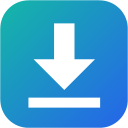
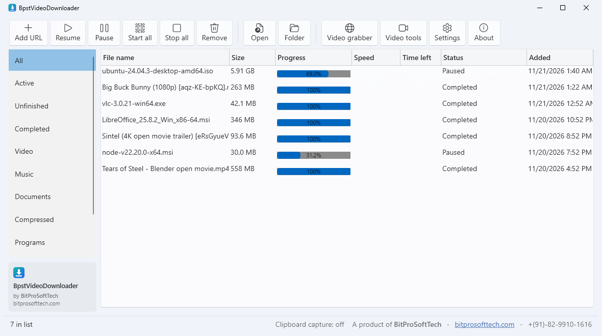

<p align="center"></p>

<h1 align="center">BDM: BPST Download Manager</h1>

<p align="center"><strong>Free, open-source download manager for Windows and Android, built with .NET 10 and .NET MAUI.</strong><br>
A product of <strong>BitProSoftTech</strong> · <a href="https://bitprosofttech.com">bitprosofttech.com</a> · +(91)-82-9910-1616</p>

<p align="center">
  <a href="https://github.com/mycodeclub/BpstDownloadManager/releases/latest/download/BDM-Setup.exe"><b>⬇ Windows</b></a> ·
  <a href="https://github.com/mycodeclub/BpstDownloadManager/releases/latest/download/BDM-android.apk"><b>⬇ Android</b></a> ·
  <a href="https://mycodeclub.github.io/BpstDownloadManager/">Project page</a> ·
  <a href="https://github.com/mycodeclub/BpstDownloadManager/releases">All releases</a>
</p>

<p align="center">
  <a href="https://github.com/mycodeclub/BpstDownloadManager/actions/workflows/build.yml"></a>
  <a href="LICENSE"></a>
  
  
</p>



> BDM is an independent project. It is not affiliated with, endorsed by or derived from any commercial download manager. All code and artwork are original and MIT licensed.

## What it downloads

| | How |
|---|---|
| **Any file**: programs, ZIPs, games, ISOs, multi-GB files | Up to 32 parallel connections, dynamic splitting, resume after pause/crash/reboot, changed-file detection, automatic retry when the network drops |
| **YouTube** | HD/4K video and audio streams downloaded in parallel and merged into one MP4. Windows uses yt-dlp + FFmpeg (installed automatically on first use); Android uses a built-in downloader and the phone's own MediaMuxer |
| **1000+ other video sites** | yt-dlp (Windows) |
| **`blob:` / streaming videos** | Video Grabber: open the page, press Play, download the HLS (`.m3u8`), DASH or MP4 stream it detects. HLS uses a built-in downloader (parallel segments, AES-128, resume) on every platform |
| **Torrents** | Magnet links and `.torrent` files, choose files, DHT, peer exchange, UPnP, fast resume, seeding ratio |

## Highlights

- **⚡ Focus mode.** Give one download the whole connection. The others slow down to a trickle but keep their connections (or pause, your choice), and everything returns to normal when it finishes.
- **Speed limit.** Set an overall limit, so downloads don't take the whole connection while you work.
- **Built for long downloads.** Per-part resume, automatic retries with backoff, a check that the server's file hasn't changed, keep-awake on Windows, and a foreground service with wake/Wi-Fi locks on Android.
- **Catches links.** Clipboard capture on Windows, "Share → BDM" on Android, magnet/.torrent file associations, `BDM.exe <link>`.
- **Facebook and Instagram videos and reels**. Public posts work straight away.
- **Sign-in for YouTube, Instagram and Facebook** (Settings → Video) for age-restricted, private, members-only and login-only videos. You sign in on the site's own page inside BDM, and the session stays on your device.
- **Smart Finder.** Search once for download links of games, software, e-books & PDFs, documents, courses and music, with category filters (Games, Software, E-books & PDF, Documents, Courses, Music & audio, Other) and a Free / Paid filter. Results come in three groups:
  - **Buy:** official stores with prices (Steam, Epic, PlayStation, Xbox, Microsoft Store, Google Play, Udemy, Amazon…).
  - **Free downloads:** open-source release files from GitHub (pick the installer and BDM downloads it), free and open-source games, F-Droid and Flathub apps, public-domain e-books (Project Gutenberg, Internet Archive), open-access research papers (arXiv), free music.
  - **Official torrents:** torrents published by the makers themselves (Linux distributions, Internet Archive).

  Cracks, repacks and piracy sites are never shown; for paid games and software, BDM points to the official stores.
- **Clear answers for paid streaming services.** Netflix, Prime Video, JioHotstar, Disney+, SonyLIV, ZEE5 and similar links are recognised up front: BDM explains that they are DRM-protected and points you to the service's own offline downloads, instead of failing halfway.
- **Light and dark themes,** a desktop sidebar and phone navigation, all from one codebase.

## Install

- **Windows 10/11:** [BDM-Setup.exe](https://github.com/mycodeclub/BpstDownloadManager/releases/latest/download/BDM-Setup.exe). Per-user install, no admin rights needed, and it upgrades BpstVideoDownloader / VeloxDM 0.x and keeps your downloads and settings.
- **Android 8+:** [BDM-android.apk](https://github.com/mycodeclub/BpstDownloadManager/releases/latest/download/BDM-android.apk). Allow "Install unknown apps" for your browser. Files are saved to **Download/BDM**.

Builds are not code-signed yet. On Windows, SmartScreen may say "Windows protected your PC": click **More info → Run anyway**. Each release lists SHA-256 checksums.

## Build

Requirements: Windows 10/11, the [.NET 10 SDK](https://dotnet.microsoft.com/download) with the MAUI workloads (`dotnet workload install maui-windows maui-android`), the Android SDK and a JDK 17+ (both come with Visual Studio's ".NET MAUI" workload).

```powershell
git clone https://github.com/mycodeclub/BpstDownloadManager.git
cd BpstDownloadManager
dotnet test tests/Bdm.Core.Tests
dotnet build src/Bdm.App -f net10.0-windows10.0.19041.0     # Windows
dotnet build src/Bdm.App -f net10.0-android                  # Android
.\build-installer.ps1 -Version 2.1.0                          # dist\BDM-Setup-2.1.0.exe + BDM-2.1.0-android.apk
```

iOS is prepared (`src/Bdm.App/Platforms/iOS`) but not shipped. Build it on a Mac with `-p:EnableIos=true`.

Real-internet tests (YouTube download + merge, torrent swarm) are opt-in: set `BDM_NET_TESTS=1`.

## Project layout

| Path | Contents |
|---|---|
| `src/Bdm.Core` | Platform-neutral engine: `SegmentedDownloader`, `HlsDownloader`, `TorrentService` (MonoTorrent), `YoutubeExplodeBackend` + `MediaDownloader` (yt-dlp), `DownloadManager` (queue, Focus, limits, retries, persistence) |
| `src/Bdm.App` | .NET MAUI app: pages, view models, `Platforms/Windows` (single instance, clipboard, keep-awake), `Platforms/Android` (foreground service, MediaMuxer, share intents), `Platforms/iOS` |
| `tests/Bdm.Core.Tests` | xUnit tests: segmented/HLS/AES/resume against a local test server, rate limiting, Focus, changed-file detection, torrents |
| `installer/BDM.iss` | Windows installer (Inno Setup) |
| `docs/` | Project website (GitHub Pages) |

App data: `%LOCALAPPDATA%\BDM` on Windows and app-private storage on Android. It holds the download list, settings, logs and, on Windows, the video tools. `BDM.exe --self-test` opens every page and exits with 0 if they all work.

## Roadmap

See [ROADMAP.md](ROADMAP.md): what's still missing in today's download managers, and what's planned for BDM.

## Responsible use

Only download content you have the right to download. Respect copyright and each site's terms. DRM-protected streams (Netflix, Prime Video, JioHotstar, Disney+…) are not supported and won't be: circumventing DRM is illegal in most countries (for example under India's Copyright Act s.65A and the US DMCA). BDM uses MonoTorrent (MIT), YoutubeExplode (LGPL-3.0) and, on Windows, the separate programs yt-dlp, FFmpeg and Deno under their own licenses.

## License

[MIT](LICENSE)
